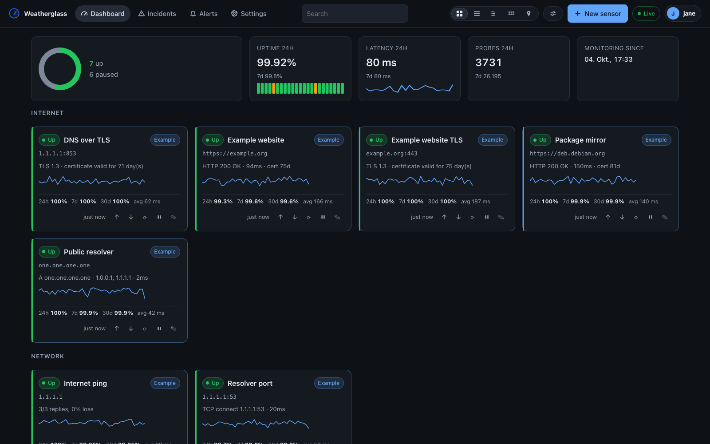
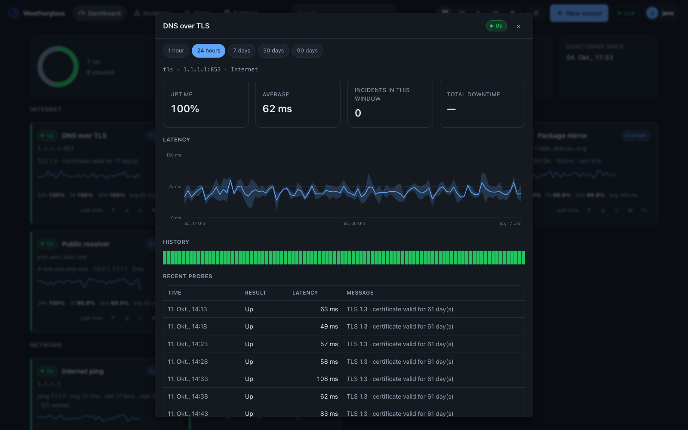
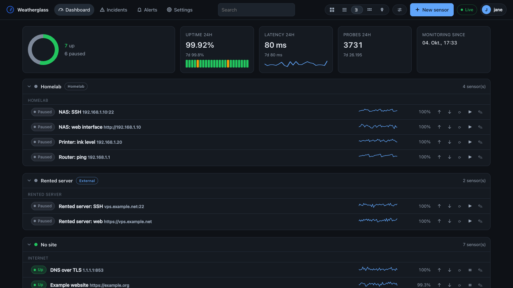
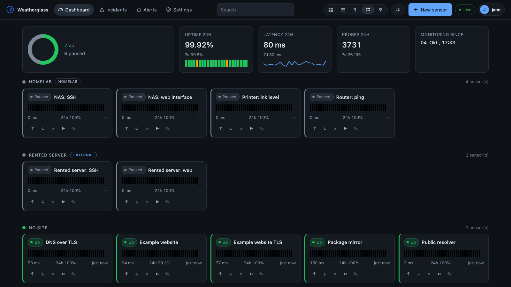
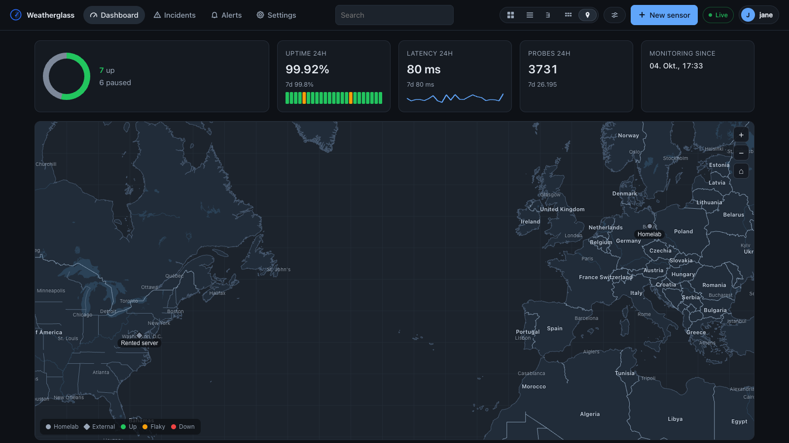
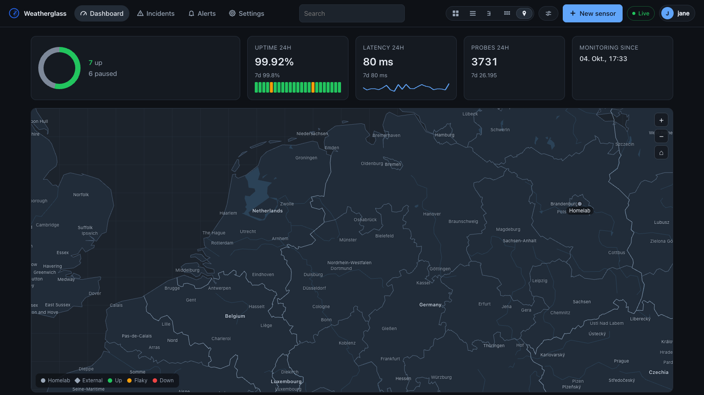

<p align="center">
  <a href="https://j000k3r.github.io/probeglass-website/">
    
  </a>
</p>

<p align="center"><em>A small, self-hosted watchdog for your homelab.</em></p>

<p align="center">
  <a href="https://github.com/j000k3r/probeglass/actions/workflows/ci.yml"></a>
  <a href="https://github.com/j000k3r/probeglass/releases"></a>
  <a href="LICENSE"></a>
  <a href="go.mod"></a>
  <a href="Dockerfile"></a>
  <a href="https://j000k3r.github.io/probeglass-docs/about"></a>
</p>

<p align="center">
  <b>Website:</b> <a href="https://j000k3r.github.io/probeglass-website/">j000k3r.github.io/probeglass-website</a> — what it does, with pictures ·
  <b>Documentation:</b> <a href="https://j000k3r.github.io/probeglass-docs/">j000k3r.github.io/probeglass-docs</a> — installation, configuration, the sensor and channel references, the HTTP API, and troubleshooting
</p>

**ProbeGlass** is a single-container monitoring daemon: it probes your services
on a schedule, keeps their history, draws the graphs, and shouts at you when
something breaks. It is built to stay out of the way — one binary, one SQLite
file, a few megabytes of RAM — while still answering the questions you actually
ask during an outage: *what is down, since when, and how often has it happened?*

---

## What it looks like

Every picture below is the real dashboard, filled with the sample data the setup
wizard creates for you — not a mock-up.

<a href="docs/images/dashboard.png"></a>

**One page, five views of the same sensors.** The **cards** above are the default.
A denser **list**, a **tree** that folds by site and group, a **wall** of tiles, and
the **map** are one click apart in the top bar.

| | |
|---|---|
| <a href="docs/images/detail.png"></a> | <a href="docs/images/dashboard-tree.png"></a> |
| <sub><b>One sensor.</b> Its charts, uptime and incidents for the window you pick — an hour to ninety days — and the raw probes they are drawn from.</sub> | <sub><b>The tree.</b> Everything the installation holds, folded by site and by group, which is how you find one sensor among a hundred.</sub> |

<a href="docs/images/dashboard-wall.png"></a>

**The wall** puts every sensor of a site on one screen with its recent history as a
heartbeat, which is what you want on a monitor on the wall of the room the rack is
in.

<a href="docs/images/dashboard-map.png"></a>

The **map** draws the world from public-domain data embedded in the binary — no
tile server, no request to anywhere, and it therefore also works on a network with
no internet. A tile URL in Settings puts real tiles underneath it, and the borders
and names are a switch.

<a href="docs/images/dashboard-map-provinces.png"></a>

Zoomed in, the provinces and their names appear, the water comes with them, and the
bigger cities fill in what a province-sized name cannot name.

---

> ## ⚖️ A hobby project, vibe coded, and nobody is liable for anything
>
> **ProbeGlass is not a product, and it is not written by a professional software
> developer.** It is one person's homelab watchdog: spare time, their own machines,
> and a codebase written in dialogue with an AI coding agent (Claude Code). It is
> shared in the hope that somebody else is looking for something similar — that is
> the whole of its ambition, and it is not an argument against any of the other
> monitoring tools out there.
>
> There is no company behind it, no support contract, no paid tier and no SLA, and
> no promise that a bug gets fixed or that a breaking change waits for a major
> version. The issue tracker is read and patches are welcome — what is not on offer
> is a timeline.
>
> It has had **no design review and no security audit**, and not every line has been
> read by a second human. Most of the code was written by the agent and then run,
> measured and corrected; some of it was written or reworked by hand. Expect the
> rough edges that come with that, and please report them.
>
> It is MIT licensed and provided **"as is", without warranty of any kind** — which
> covers data loss, a container that will not start, and the case this project
> exists to catch: **a service that was down for a day while the dashboard said it
> was fine. Do not make it your only line of defence.** If a missed alert would cost
> you money, keep a second, independent check on the things that matter most.
>
> How it came about, how it is written today, and what that means for you:
> [**Who makes this, and how**](https://j000k3r.github.io/probeglass-docs/about).

---

**Where to go next:** [Why another monitor?](#why-another-monitor) ·
[Features](#features) · [Quick start](#quick-start) · [Sensors](#sensors) ·
[Alerts](#alerts) · [Configuration](#configuration) · [HTTP API](#http-api) ·
[Operating](#operating) · [Development](#development) · [Status](#status) ·
[License](#license)

## Why another monitor?

There are other monitoring tools, and this is not an argument against any of
them. There is also no shortage of them. It is simply that most of them are a lot
bigger than a homelab needs, in memory and in moving parts. ProbeGlass makes
the opposite bet:

| | ProbeGlass | Typical container-based monitor |
|---|---|---|
| Memory at idle | ~3 MB | 200–400 MB |
| Runtime deps | none (static binary) | Node.js, or a JVM, or a full stack |
| Frontend build | none — plain ES modules, embedded in the binary | npm, a bundler, a CDN |
| Dependencies | pure Go, including SQLite (no CGO) | native modules |
| Data | one SQLite file you can copy | a database server or a volume full of JSON |

The whole program is a Go binary with the dashboard baked in via `embed.FS`.
There is no build step between editing a `.js` file and reloading the page, and
building the image needs nothing but the Go toolchain — no npm, no bundler, no
frontend pipeline to keep alive.

## Features

- **Sensors** — HTTP(S), TCP (with optional TLS and send/expect), TLS certificate
  expiry, ICMP ping, DNS, Docker containers, and SNMP. Configured in the web UI or
  declared in YAML.
- **Dashboard** — five views of the same sensors: cards, a dense list, a foldable
  **tree** by site and group, a **wall** of tiles carrying the last forty checks as
  a heartbeat, and a **map** of your sites. The map draws the world from
  public-domain data embedded in the binary — coastlines, the lakes and rivers,
  country, district and province
  borders, and the names of countries, provinces, cities and towns, appearing as you
  zoom —
  so it works on a network
  with no internet and tells nobody anything; a tile URL in Settings puts real
  tiles under it for anybody running a tile server of their own, and a switch turns
  the borders and names off without touching the water. Two
  exceptions to the public domain: Austria's district borders come from Statistik
  Austria and the town names from GeoNames, both under CC BY 4.0, which asks to be
  named — say so wherever you show them. One
  setting, not five pages, with a switcher in the top bar. Per-sensor
  response-time charts, uptime bars, incident timeline. Updates over SSE: a probe
  result redraws the one card it belongs to — the status dot, the latency, the
  sparkline and the heartbeat — instead of reloading the page, so an open tree
  branch stays open and the focus stays where you put it. A **Live** indicator in
  the top bar shows whether the stream is connected and turns it off entirely with
  one click.
- **Search** — one field in the middle of the top bar, looking through everything
  the installation holds: sensors, sites, channels, incidents, the individual probe
  messages of the retention window, the settings panels, and (for administrators)
  the accounts. Press a hit and it takes you there — open the sensor, jump to the
  settings panel, show the outage in its own context. Credentials are never
  searched: a sensor's options and a channel's configuration are not looked
  through, and a search box that answers with a bot token is worse than none.
- **Sites** — the places your sensors are: the rack in the cellar, the VPS at a
  hoster. A site has a kind (`local` or `external`) and optional coordinates; it
  groups the tree and the wall, and with coordinates it is drawn on the map.
  Optional throughout — a sensor without a site behaves exactly as it did before
  sites existed.
- **History** — raw samples for 7 days, hourly rollups for 90 days, daily
  rollups forever. Uptime percentages stay correct at every zoom level because
  exactly one resolution answers any given range.
- **Incidents** — a sensor that starts failing opens an incident, a recovery
  closes it. You see what is broken *now* and what broke last Tuesday, and the
  list filters by state, by sensor, by period and by a word you remember from the
  message — with a reset that puts the whole list back. An open incident can be
  **acknowledged** with a note: the reminders stop, the probing and the history do
  not, and the recovery alert still arrives.
- **Alerts** — Telegram, Discord, Matrix, ntfy, Slack, and generic webhooks with
  an HMAC signature. Per-sensor channel selection, per-sensor reminder intervals,
  custom message templates.
- **Two interfaces, one program** — choose a **simple** or **advanced** interface
  during setup and change it later. Simple hides the areas a casual user does not
  need and folds the rest; it never disables anything, so a sensor keeps probing
  at the interval it had. Every field carries a `?` that opens one sentence about
  what it is for and one example, instead of a paragraph under the form.
- **Not empty on day one** — setup creates four example sensors (this dashboard, a
  gateway, a public resolver, a public website), attached to no channel, so there
  is something to look at before you have configured anything: they arrive with a
  week of history, an outage to explain, and one of them reading **Flaky**,
  which is what the dashboard looks like once it is doing its job. They are marked
  as examples and can be removed in one click from Settings.
- **Troubleshooting built in** — `probeglass doctor` on the command line, and
  the same checks in the dashboard under Settings → Diagnostics, with the
  `docker exec` command to run it yourself.
- **Auth** — first-run setup creates the first account (a username and a
  password, with a strength indicator), and every account is a viewer, an
  operator or an admin. Passwords are bcrypt, sessions are signed cookies that
  carry the account and are re-checked on every request, and two-factor
  authentication (TOTP) is optional per account and comes with eight one-time
  recovery codes. An API key is available for scripts and Home Assistant.
- **Backup and restore** — Settings → Backup writes the installation out as one
  JSON file: the configuration and the accounts, or that plus the incidents and the
  hourly and daily rollups of the last 7, 30 or 90 days, or of everything. A restore
  checks the file, takes a byte-exact `VACUUM INTO` safety copy beside the database,
  and replaces only what the file names, so a configuration rollback never wipes
  history. **The file carries every secret in clear text** — password hashes, TOTP
  secrets, the API key and every channel's credentials — because a backup with
  masked credentials restores a channel that cannot send anything. See
  [SECURITY.md](SECURITY.md).
- **Config as code** — sensors, sites and channels can be declared in a YAML file,
  so a rebuild from zero takes seconds.
- **Small** — a ~14 MB static binary in a 27 MB image (about 6 MB to pull),
  distroless, no shell, no package manager, ~3 MB of RAM while idle. The container
  starts as root only long enough to take its data directory over and drops to
  `PUID:PGID` before it opens anything — see [SECURITY.md](SECURITY.md).

## Quick start

### Docker Compose

```bash
git clone https://github.com/j000k3r/probeglass.git
cd probeglass
docker compose up -d
```

Then open <http://localhost:8080> and create the first account in the setup
wizard.

### Docker

```bash
docker run -d \
  --name probeglass \
  --restart unless-stopped \
  -p 8080:8080 \
  -v probeglass-data:/data \
  --cap-add NET_RAW \
  ghcr.io/j000k3r/probeglass:0.2.1
```

Every release is published under three tags: `0.2.1`, the exact version;
`0.1`, which follows the 0.1.x patch releases; and `latest`, which follows the
newest release of all. `dev` is a build of whatever is in the tree today.

`NET_RAW` is only needed for ICMP ping sensors. Without it, ProbeGlass falls
back to an unprivileged UDP ping and tells you in the sensor result if that is
not available either.

Building the image yourself needs BuildKit (`docker buildx`), because the
Dockerfile pins its builder to `$BUILDPLATFORM` and cross-compiles to the target
architecture rather than emulating it. BuildKit is bundled with Docker Desktop
and is the default on current Docker engines; with Homebrew's `docker` formula
it is a separate `brew install docker-buildx`. Without it, `make run` builds and
serves the same binary natively.

### From source

```bash
make run          # builds the binary and serves :8080, data in ./data
make seed         # fills ./data with demo sensors and a week of synthetic history
make test         # runs the test suite
```

### Try it with demo data

```bash
docker run --rm -p 8080:8080 -v probeglass-demo:/data \
  ghcr.io/j000k3r/probeglass:0.2.1 seed --demo --days 7
docker run --rm -p 8080:8080 -v probeglass-demo:/data \
  ghcr.io/j000k3r/probeglass:0.2.1 serve --listen :8080
```

The demo set brings invented sensors of several types, a week of plausible
history with outages in it, and **no** alert channels — a seeded install never
sends you anything, which is the right default for something you are only
looking at. Delete the volume when you are done.

## Sensors

A sensor is a name, a type, a target, an interval, and a handful of options that
depend on the type. Everything is editable in the UI; the same objects can be
declared in YAML.

| Type | Target | Useful options |
|---|---|---|
| `http` | a URL | `method`, `expected_status`, `headers`, `user_agent`, `basic_auth_user`/`basic_auth_pass`, `bearer_token`, `body`, `body_contains`, `body_not_contains`, `body_regex`, `expected_headers`, `max_body_bytes`, `follow_redirects`, `insecure_skip_verify`, `cert_warn_days` |
| `tcp` | `host:port` | `tls`, `server_name`, `insecure_skip_verify`, `send` (supports `\r` and `\n`), `expect` |
| `ping` | host or IP | `count` (echo requests, default 3) |
| `dns` | hostname | `record_type` (A, AAAA, CNAME, MX, TXT, NS, SRV, PTR), `resolver`, `expected`, `expect_all` |

Common to all types: `interval`, `timeout`, `retries` (how many consecutive
failures before an incident opens), `group`, `tags`, `reminder_every`,
`enabled`, and the list of notification channels.

```yaml
sensors:
  - name: Router
    type: ping
    target: 192.168.1.1
    interval: 30s
    retries: 3
    group: Network

  - name: Nextcloud
    type: http
    target: https://cloud.example.org/status.php
    interval: 60s
    timeout: 10s
    options:
      expected_status: 200
      body_contains: '"installed":true'
    channels: [telegram]

  - name: DNS resolves the web host
    type: dns
    target: cloud.example.org
    interval: 5m
    options:
      record_type: A
      expected: 10.0.0.42
```

## Alerts

| Channel | Required fields |
|---|---|
| Telegram | bot token, chat ID |
| Discord | webhook URL |
| Matrix | homeserver URL, access token, room ID |
| ntfy | topic (plus server URL, optional token and priority) |
| Slack | webhook URL |
| Webhook | URL (plus optional method and HMAC secret) |

Every channel takes an optional `title_template` and `body_template` — Go
`text/template` strings rendered against the sensor name, type, target, status,
message, latency, incident start, and duration. The built-in wording differs per
event (down, reminder, recovery, test), and a template that fails to parse or
execute falls back to it rather than losing the alert.

Generic webhooks POST a JSON payload and, when a secret is configured, sign the
exact request body with HMAC-SHA256 in the `X-ProbeGlass-Signature` header.
The event name travels in `X-ProbeGlass-Event` (`down`, `up`, `reminder`, or
`test`).

Credentials are never returned by the API — the UI shows a `StoredMarker`
placeholder instead — and the Telegram bot token is stripped from error
messages, so a failed send cannot leak it into your logs.

## Configuration

The dashboard stores its settings in the database; the process reads its
configuration from four places. Later sources win:

1. built-in defaults
2. a YAML file — `-config PATH`, else `$PROBEGLASS_CONFIG`, else
   `<data_dir>/probeglass.yaml` if that file exists
3. `PROBEGLASS_*` environment variables
4. command-line flags

```yaml
listen: ":8080"
data_dir: /data
base_url: https://probeglass.lan     # used in links inside alerts
log_level: info                        # debug | info | warn | error
log_format: text                       # text | json
trust_proxy: false                     # honour X-Forwarded-* from a reverse proxy

retention:
  raw: 7d                              # individual probe results
  hourly: 90d                          # hourly rollups (daily rollups are kept forever)
```

Every key has an environment variable: `PROBEGLASS_LISTEN`,
`PROBEGLASS_DATA_DIR`, `PROBEGLASS_DB`, `PROBEGLASS_BASE_URL`,
`PROBEGLASS_LOG_LEVEL`, `PROBEGLASS_LOG_FORMAT`,
`PROBEGLASS_ADMIN_PASSWORD`, `PROBEGLASS_TRUST_PROXY`,
`PROBEGLASS_RETENTION_RAW`, `PROBEGLASS_RETENTION_HOURLY`.

Durations accept Go syntax (`30s`, `5m`, `2h`) plus the day and week suffixes
these settings are naturally written in (`7d`, `90d`, `2w`), or a bare number of
seconds.

`PROBEGLASS_ADMIN_PASSWORD` creates an administrator account named `admin` on
a database that has no accounts at all, and is ignored afterwards — handy for
automated deployments, harmless afterwards.

See [docs/CONFIGURATION.md](docs/CONFIGURATION.md) for the full reference.

## HTTP API

The dashboard is a client of the same API you can script against. Authenticate
with the session cookie or, for scripts, with `X-API-Key` (or
`Authorization: Bearer`). Generate a key in **Settings → API key**. The key is
not tied to an account and has full administrator rights, so treat it like a
root password.

```bash
curl -H "X-API-Key: $PG_KEY" http://localhost:8080/api/summary | jq
curl -H "X-API-Key: $PG_KEY" localhost:8080/api/sensors/1/series?range=24h | jq
curl -H "X-API-Key: $PG_KEY" localhost:8080/api/sensors/1/uptime?range=30d | jq
```

A route's method is also its permission boundary. Reads are open to every
signed-in role; acting on an outage needs the operator role; changing the
configuration, the API key or the accounts needs the admin role. The few routes
that touch only the caller's own account — `GET`/`PUT /api/settings`,
`PUT /api/password`, `/api/me/totp/*` and `POST /api/onboarding/tour` — sit at
viewer, because they are nobody else's business.

| Method | Path | Purpose |
|---|---|---|
| `GET` | `/healthz` | liveness, no auth |
| `GET` | `/api/version` | version, commit, build date |
| `GET` | `/api/session` | whether setup is needed, and who you are |
| `POST` | `/api/setup` | create the first account (`username`, `password`, `mode`) |
| `POST` | `/api/login`, `/api/login/totp` | sign in, and finish sign-in with a TOTP or recovery code |
| `POST` | `/api/logout` | sign out |
| `GET` | `/api/summary` | everything the dashboard needs in one call |
| `GET` | `/api/events` | SSE stream of live status changes |
| `GET` | `/api/sensors` | list sensors |
| `POST` | `/api/sensors` | create a sensor (admin) |
| `GET` | `/api/sensors/{id}` | read one sensor |
| `PUT`/`DELETE` | `/api/sensors/{id}` | update or delete (admin; updates are partial) |
| `PATCH` | `/api/sensors/{id}` | pause or resume; accepts only `enabled` (operator) |
| `POST` | `/api/sensors/validate` | validate a draft without saving |
| `POST` | `/api/sensors/{id}/probe` | run one probe now |
| `GET` | `/api/sensors/{id}/results` | recent raw samples |
| `GET` | `/api/sensors/{id}/series` | downsampled series for charts |
| `GET` | `/api/sensors/{id}/uptime` | uptime and response-time statistics |
| `GET` | `/api/sensors/{id}/incidents` | outage history for one sensor |
| `GET` | `/api/incidents` | all incidents, newest first; filter with `state`, `sensor`, `range`/`since`, `q` |
| `POST` | `/api/incidents/{id}/ack` | acknowledge an outage, with a note |
| `DELETE` | `/api/incidents/{id}/ack` | take the acknowledgement back |
| `POST` | `/api/sensors/{id}/ack` | acknowledge whatever that sensor has open |
| `GET` | `/api/search` | search sensors, sites, channels, incidents, probe messages, settings and (for admins) accounts |
| `PUT` | `/api/sensor-order` | reorder the dashboard (admin) |
| `GET`/`POST` | `/api/sites` | list the places sensors live, or create one (create is admin) |
| `PUT`/`DELETE` | `/api/sites/{name}` | rename or delete; a delete is refused while sensors are on it, or takes `?unassign=1` (admin) |
| `PUT` | `/api/map` | the installation-wide tile URL, attribution and borders switch (admin) |
| `GET` | `/api/channels` | list alert channels |
| `POST` | `/api/channels` | create a channel (admin) |
| `GET` | `/api/channel-types` | field descriptions and the per-type setup recipe, drives the UI forms |
| `PUT`/`DELETE` | `/api/channels/{id}` | update or delete (admin) |
| `POST` | `/api/channels/test`, `/api/channels/{id}/test` | send a test alert (admin) |
| `GET/PUT` | `/api/settings` | the account's interface preferences |
| `POST` | `/api/onboarding/tour` | remember how far the guided tour got |
| `PUT` | `/api/password` | change your own password |
| `POST` | `/api/me/totp/start`, `/api/me/totp/confirm`, `/api/me/totp/disable`, `/api/me/totp/recovery` | enrol, confirm or remove two-factor authentication |
| `GET` | `/api/me/totp/qr` | the enrolment QR code, as a PNG |
| `POST` | `/api/doctor` | run the self-check and return its report |
| `POST`/`DELETE` | `/api/api-key` | rotate or remove the API key (admin) |
| `GET/POST` | `/api/users` | list and create accounts (admin) |
| `PUT`/`DELETE` | `/api/users/{id}` | change a role, disable or delete an account (admin) |
| `POST` | `/api/users/{id}/password` | reset somebody's password (admin) |
| `GET`/`DELETE` | `/api/examples` | count or remove the sample sensors (delete is admin) |
| `GET` | `/api/backup` | download the installation as JSON — `?scope=config\|history&days=7\|30\|90\|all` (admin) |
| `POST` | `/api/restore` | read a backup back in; the file is the request body (admin) |

Mutating requests are checked against `Origin`, so a browser on another site
cannot drive the API even with a valid cookie.

## Operating

- **Data** lives in a single SQLite file (default `/data/probeglass.db`,
  WAL mode). Back up that file, or the whole volume, and you have backed up
  everything — byte for byte, which is still the right backup when you want
  everything. For a portable copy that can be trimmed, **Settings → Backup** writes
  the installation out as one JSON file and reads one back in, and takes a
  byte-exact safety copy of the database before it restores anything. The file
  holds secrets in clear text; [SECURITY.md](SECURITY.md) says what and why.
- **Health** — the image has a `HEALTHCHECK` that runs `probeglass
  healthcheck`, so `docker ps` shows the real state without needing a shell in
  the image.
- **Diagnosis** — when something is wrong, `docker exec probeglass probeglass
  doctor` says what: the configuration, the data directory, the database's
  integrity and schema, the stored sensors, and whether the daemon is answering.
  It opens the database read-only and never sends an alert, so it is safe on a
  database you are worried about.
- **Upgrades** — pull the new tag and restart; migrations run at startup.
- **Reverse proxy** — set `base_url` and `trust_proxy: true` so links in alerts
  and the client IP the API sees are correct. The session cookie deliberately
  has no `Secure` flag, because homelab installs are usually plain HTTP on the
  LAN; terminate TLS at your proxy if you need it.

## Development

```
cmd/probeglass     entrypoint: serve, version, healthcheck, doctor, seed
internal/api         HTTP handlers, sessions, accounts, middleware, SSE
internal/totp        RFC 6238 one-time passwords, written out in full
internal/doctor      read-only inspection for `probeglass doctor`
internal/sensor       one engine per sensor type
internal/notify      alert channels, templating, delivery
internal/scheduler   one goroutine per sensor, incident lifecycle
internal/store       SQLite schema, queries, rollups, retention
internal/model       shared types and options
internal/config      YAML, environment, flags, validation
internal/web         embedded dashboard (HTML, CSS, plain ES modules)
```

`make` on its own lists every task. The useful ones are `make run`,
`make dev`, `make test`, `make test-race`, `make cover`, `make lint`,
`make docker`, and `make rename MODULE=github.com/you/probeglass`.

CI runs `gofmt`, `go vet`, `go test -race`, a build for each of the three
architectures the image ships, and `golangci-lint`. There is no frontend build
step.

See [docs/ARCHITECTURE.md](docs/ARCHITECTURE.md) for how the pieces fit
together, [CONTRIBUTING.md](CONTRIBUTING.md) for how to send a patch, and
[docs/ROADMAP.md](docs/ROADMAP.md) for what is planned next.

The user-facing documentation lives in its own repository and is published from
there: **<https://j000k3r.github.io/probeglass-docs/>**. This repository keeps
the documents that belong with the code. The container image is published to the
GitHub Container Registry, `ghcr.io/j000k3r/probeglass`, by the release workflow.

## Status

Version 0.2.1 — the foundation is in place and works, the feature set is still
growing. The dashboard ships in English and German, the switch is in Settings and
in the account menu, and the UI is built on a message catalogue, so the next
language is a dictionary file and a picker entry. The container image is the only
thing a release publishes.

This is a hobby project with no warranty and no support commitment, and the code is
written in dialogue with an AI coding agent. [Who makes this, and
how](https://j000k3r.github.io/probeglass-docs/about) is the honest version, and it
is worth two minutes before you install this anywhere that matters.

## License

MIT — see [LICENSE](LICENSE). In plain words: use it, change it, ship it, keep the
notice — and accept that it comes with no warranty of any kind and that nobody is
liable for anything it does. It is a hobby project, not a product.

---

## Star History

<p align="center">
<a href="https://www.star-history.com/?repos=j000k3r%2Fprobeglass&type=date&legend=top-left">
 <picture>
   <source media="(prefers-color-scheme: dark)" srcset="https://api.star-history.com/chart?repos=j000k3r/probeglass&type=date&theme=dark&legend=top-left" />
   <source media="(prefers-color-scheme: light)" srcset="https://api.star-history.com/chart?repos=j000k3r/probeglass&type=date&legend=top-left" />
   
 </picture>
</a>
  <br>
  <sub>Nothing here is for sale and nothing is asked for. A star is the only
  measurement this project has of whether it was worth writing.</sub>
</p>

